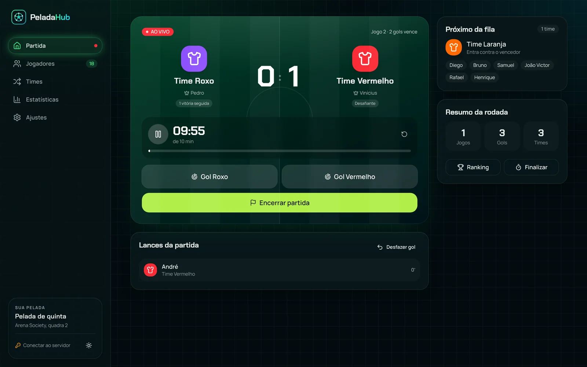
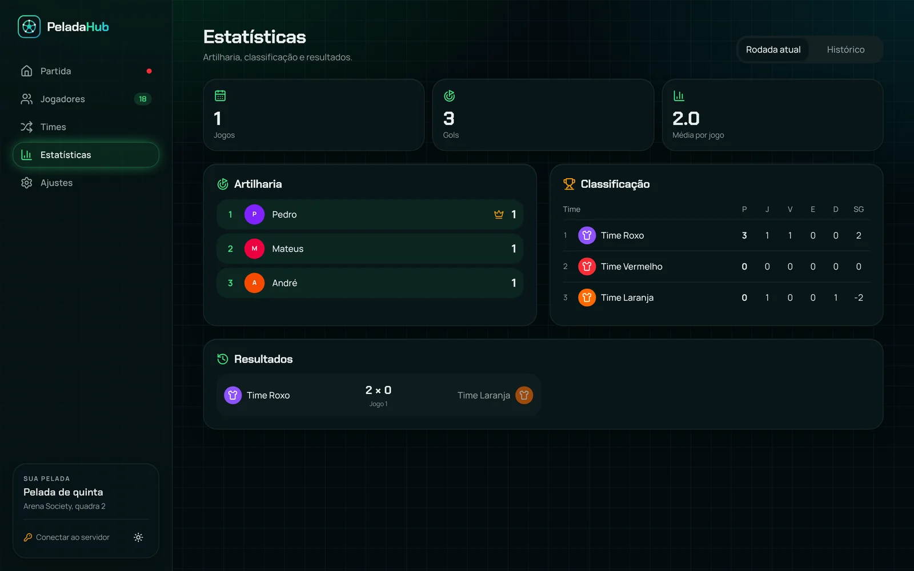
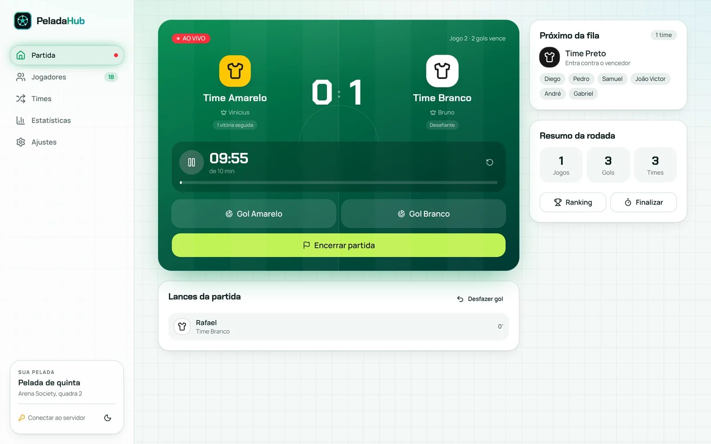
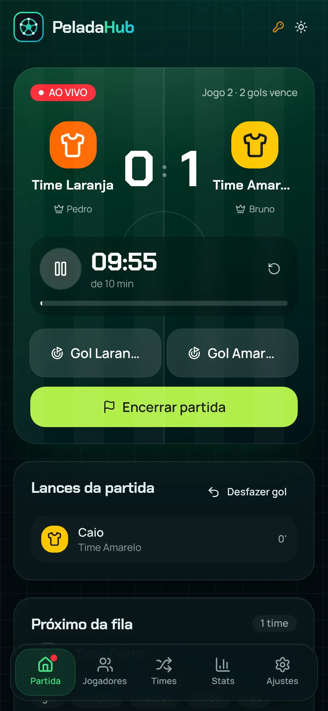
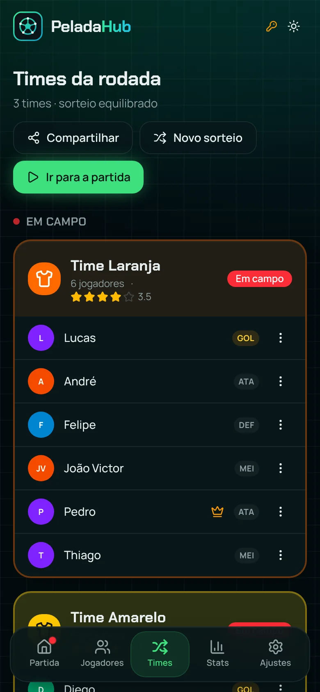
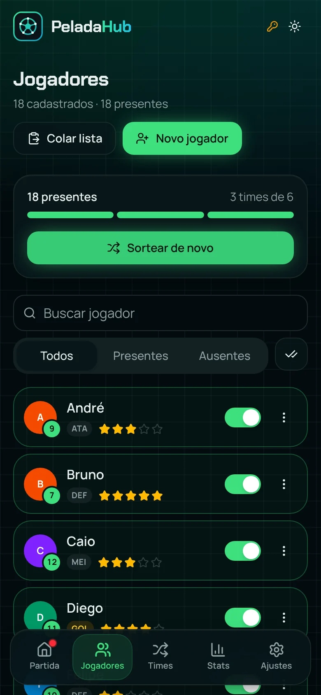
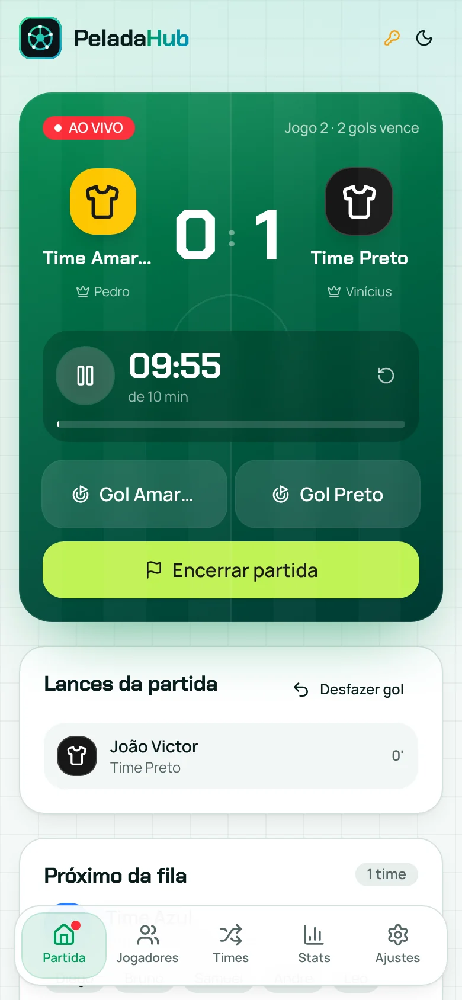

<div align="center">


# PeladaHub

**Organize a pelada sem planilha e sem discussão.**<br />
Presença, sorteio equilibrado, placar ao vivo, fila de times e artilharia, tudo no celular, à beira do campo.
<p>
  <a href="https://v2pelada-h-ub-frontend.vercel.app/"><strong>🔗 Acesse o app ao vivo</strong></a>
</p>
<p>
  
  
  
  
  
  
  
</p>



</div>

---

## ⚽ Por que existe

Toda pelada tem o mesmo ritual: alguém cola a lista no grupo, outro tenta montar times parelhos "no olho", ninguém lembra quem ganhou a última e a fila de quem está de fora vira discussão. O **PeladaHub** resolve isso em poucos toques, direto do celular do organizador.

## ✨ Funcionalidades

| | |
| --- | --- |
| 📋 **Lista do WhatsApp** | Cole a lista do grupo e todo mundo entra de uma vez. Números, traços e emojis são ignorados. |
| ✅ **Presença por chegada** | Marque quem chegou. A ordem de chegada decide quem fica de fora quando a conta não fecha. |
| ⚖️ **Sorteio equilibrado** | Cada jogador tem posição e nível de 1 a 5 estrelas. O sorteio monta times parelhos e coloca um goleiro em cada time. |
| ⏱️ **Placar ao vivo** | Cronômetro regressivo, apito e vibração no fim do tempo, e aviso quando alguém atinge os gols para vencer. |
| 🥅 **Autor do gol** | Toque em "Gol", escolha quem marcou. Errou? Desfaça com um toque. |
| 🔁 **Fila automática** | Quem ganha fica, o perdedor vai para o fim da fila. Limite de vitórias seguidas e regra de empate configuráveis. |
| 🏆 **Estatísticas** | Artilharia, classificação dos times (P, J, V, E, D, SG), resultados e histórico de rodadas. |
| 📲 **Compartilhar** | Mande os times sorteados para o grupo com um toque. |
| 🌗 **Claro e escuro** | Tema "estádio à noite" no modo escuro, e claro para o sol da tarde. |
| 📶 **Funciona offline** | Instale como app (PWA). Tudo é salvo no aparelho e, com o PIN do organizador, também no servidor. |

## 📸 Telas

<table>
  <tr>
    <td width="50%"></td>
    <td width="50%"></td>
  </tr>
  <tr>
    <td align="center"><sub>Artilharia e classificação</sub></td>
    <td align="center"><sub>Modo claro</sub></td>
  </tr>
</table>

<p align="center">
  
  
  
  
</p>

## 🧱 Tecnologias

**Front-end**
- [React 19](https://react.dev) + [TypeScript](https://www.typescriptlang.org) + [Vite](https://vite.dev)
- [Tailwind CSS 4](https://tailwindcss.com) com componentes no estilo [shadcn/ui](https://ui.shadcn.com) sobre [Radix UI](https://www.radix-ui.com) (acessíveis por teclado e leitor de tela)
- [Zustand](https://zustand.docs.pmnd.rs) para o estado, [Motion](https://motion.dev) para as animações, [Lucide](https://lucide.dev) para os ícones e [Sonner](https://sonner.emilkowal.ski) para as notificações
- PWA com [vite-plugin-pwa](https://vite-pwa-org.netlify.app) e testes com [Vitest](https://vitest.dev)

**Back-end**
- Java 17 com o servidor HTTP embutido do JDK, sem framework
- MySQL via JDBC, empacotado com Maven em um único JAR
- Docker pronto para deploy no Render ou Railway

## 🗂️ Estrutura

```text
.
├── frontend/                 # app React (gera o build em src/main/resources/static)
│   └── src/
│       ├── pages/            # uma tela por rota: Partida, Jogadores, Times, Estatísticas, Ajustes
│       ├── features/         # partes de cada tela (placar, diálogo de gol, card de time...)
│       ├── components/       # layout, logo e componentes visuais (ui/ = botões, diálogos...)
│       ├── lib/              # regras do jogo sem interface: sorteio, fila, placar (com testes)
│       ├── store/            # estado da aplicação e sincronização com o servidor
│       └── hooks/            # cronômetro, tema e outros hooks
├── src/main/java/com/peladahub/
│   ├── WebServer.java        # serve o app e a API /api/state (protegida por PIN)
│   ├── connection/           # conexão com o MySQL
│   ├── dao/  model/          # acesso a dados e entidades
│   └── Main.java
├── Dockerfile                # build do front (Node) + back (Maven) em uma imagem
└── render.yaml               # deploy no Render
```

## 🚀 Como rodar

**Pré-requisitos:** Node 20+, Java 17, Maven e um MySQL.

```bash
# 1. Front-end em modo desenvolvimento (abre em http://localhost:5173)
cd frontend
npm install
npm run dev

# 2. Testes da lógica de sorteio e fila
npm test

# 3. Build completo: o front vai para dentro do JAR
npm run build
cd ..
mvn package
DB_USER=pelada DB_PASSWORD=senha PELADAHUB_PIN=1234 java -jar target/peladahub-1.0-SNAPSHOT.jar
```

Em modo desenvolvimento, as chamadas para `/api` são encaminhadas para o Java em `localhost:8080`.

**Com Docker**, o `Dockerfile` faz tudo:

```bash
docker build -t peladahub .
docker run -p 8080:8080 -e DB_URL=... -e DB_USER=... -e DB_PASSWORD=... -e PELADAHUB_PIN=... peladahub
```

## 🔐 Configuração e segurança

| Variável | Obrigatória | Para que serve |
| --- | --- | --- |
| `DB_URL` | não | URL JDBC do MySQL (padrão: `localhost:3306/pelada_db`) |
| `DB_USER` | sim | Usuário do banco |
| `DB_PASSWORD` | sim | Senha do banco |
| `PELADAHUB_PIN` | recomendada | PIN do organizador. Sem ele, um PIN temporário é gerado a cada inicialização e aparece no log |

- A API `/api/state` só responde com o cabeçalho `X-PeladaHub-Pin` correto. Depois de 5 PINs errados, o IP fica bloqueado por 5 minutos.
- No app, o organizador informa o PIN em **Ajustes → Servidor**. Sem PIN, o app funciona normalmente e salva só no aparelho.
- O servidor envia cabeçalhos de segurança (CSP, `X-Frame-Options`, `nosniff`, `Referrer-Policy`) e limita o tamanho dos dados salvos.

## 🎯 Objetivo

Projeto desenvolvido para praticar **Java, POO, SQL, JDBC, banco de dados e organização de sistemas**, e evoluído com um front-end moderno para servir como projeto de portfólio.

## 👨‍💻 Autor

**Lucas Henrique Rodrigues Rabelo**
